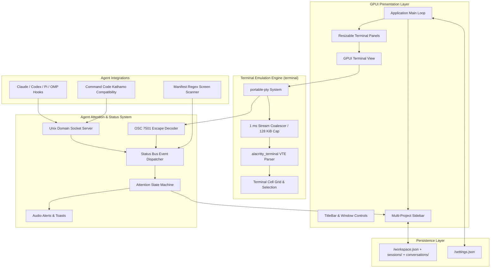
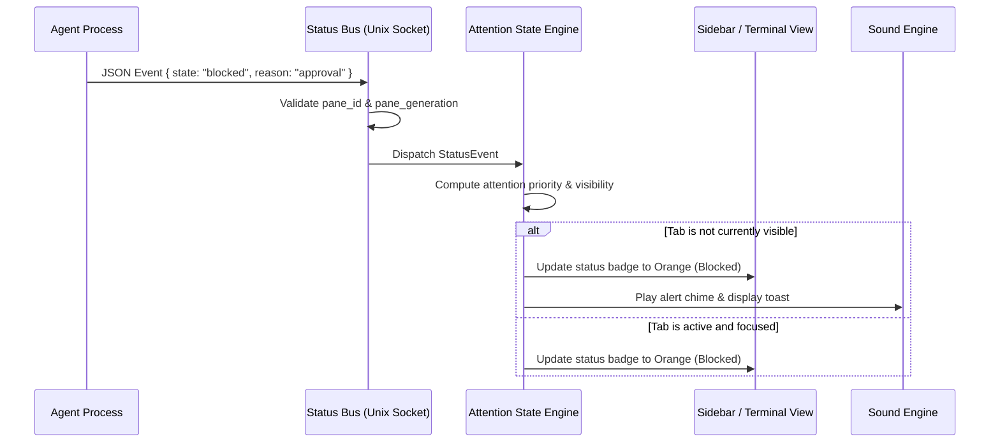

# Kathamo Architecture

This document describes the architectural design, core subsystems, and data flows of the **Kathamo** terminal emulator.

---

## 1. System Overview

Kathamo is designed around three primary concerns:
1. **High-throughput, GPU-accelerated terminal emulation** using GPUI and Alacritty's VTE parser.
2. **Autonomous AI agent state tracking** via an IPC status bus and the Kathamo attention protocol.
3. **Multi-project workspace management** with persistent project-scoped terminal sessions.



---

## 2. Core Subsystems

### 2.1 Terminal Emulation (`terminal`)

The terminal widget is implemented in the `terminal` sub-crate:
- **PTY Management**: Spawns user shells using `portable-pty` with asynchronous read and write loops.
- **Throughput Protection**: Uncontrolled terminal streams (e.g., fast compiler output or large file dumps) can overwhelm desktop UI threads. Kathamo employs an adaptive **1 ms stream coalescer** and a **128 KiB parse cap per frame**. This ensures UI responsiveness even at stream rates exceeding 40 MB/s.
- **Rendering**: Terminal glyphs and styling (bold, italic, 24-bit RGB true color) are painted directly via GPUI primitives using embedded monospace fonts (`Mononoki`).

### 2.2 Status Bus & IPC (`src/status_bus.rs`, `src/status.rs`)

The status bus receives events from running agent processes:
- **Unix Domain Socket**: Kathamo binds a private per-user Unix socket at `$XDG_RUNTIME_DIR/kathamo-status.sock` (or `/tmp/kathamo-$UID/status.sock`).
- **Generation Authentication**: Each terminal pane receives a unique `pane_generation` token in its environment (`KATHAMO_PANE_GENERATION`). The status bus verifies this token to reject stale or unauthorized events from old processes.
- **OSC 7501 Fallback**: For environments where local sockets cannot be bridged, agents can emit custom OSC 7501 ANSI sequences directly to stdout (`\x1b]7501;state=working...\x1b\`).

### 2.3 Agent Attention Model (`src/attention.rs`)

Kathamo implements the agent attention model to eliminate notification fatigue while guaranteeing critical tasks are never missed:
- **Attention Hierarchy**:
  $$\text{Blocked} > \text{Done} > \text{Working} > \text{Idle}$$
  - `Error` ranks as `Blocked`.
  - `Unknown` and `Active` rank as `Idle`.
- **Unviewed Completion Latching**:
  - When an agent finishes while focused and visible, its status transitions directly to `idle`/`active` without ringing bells.
  - When an agent finishes while unfocused or in a hidden tab, its status latches to `done`. An audio alert plays and a notification toast appears. Switching to that tab automatically clears the status to `idle`.
- **Sub-Agent / Worker Hierarchy**: Child sessions (reporting an `agent_id`) are grouped under their parent session without raising independent notifications or corrupting the parent's status.

### 2.4 Agent Integrations (`src/integrations.rs`, `src/agent_rules.rs`)

Kathamo provides automated one-command setup for developer agent ecosystems:
- **Claude Code**: Hooks registered into `~/.claude/settings.json`.
- **Codex**: Hooks registered into `~/.codex/hooks.json`.
- **Pi & OMP**: Extension modules placed into dedicated agent directories.
- **OpenCode**: Upstream V2 TUI session listener plugin (`assets/integrations/opencode-tui.js`).
- **Command Code**: Direct native compatibility via socket environment variables (`KATHAMO_SOCKET_PATH`, `KATHAMO_PANE_ID`).
- **Screen Detection**: Embedded TOML manifests (`assets/agent-detection/*.toml`) evaluate regex patterns on visible terminal screen buffers to detect agent activity without requiring agent configuration.

### 2.5 Workspace State & Persistence (`src/workspace_state.rs`, `src/settings.rs`, `src/conversations.rs`)

Kathamo follows Zed's per-platform directory convention (`src/paths.rs`):

| Platform | Data dir | Config dir |
|---|---|---|
| Linux | `$XDG_DATA_HOME/kathamo` (`~/.local/share/kathamo`) | `$XDG_CONFIG_HOME/kathamo` (`~/.config/kathamo`) |
| macOS | `~/Library/Application Support/Kathamo` | `~/.config/kathamo` |
| Windows | `%LOCALAPPDATA%\Kathamo` | `%APPDATA%\Kathamo` |

```
<data>/
  workspace.json              # v2: projects -> sessions (tabs) -> panes + split tree
  sessions/<pane-uid>.txt     # captured terminal output per pane (2 000 lines / 256 KiB cap)
  conversations/<pane-uid>/   # append-only JSONL agent transcripts
  backups/                    # pre-v2 workspace backups
  logs/
<config>/settings.json        # theme, palette, sidebar, default model, window geometry, restore toggles
```

- `settings.json` is user-editable and parsed as JSONC (comments allowed). It stores app appearance, window bounds/state, and the `restore` toggles.
- `workspace.json` is auto-managed and debounced (300 ms) with an atomic temp+rename write and a generation guard. It records project paths, tab titles/logos, the split tree, per-pane cwd, input drafts, command history, and selected agent models/session ids.
- Scrollback is written separately (on close, quit, and every 30 s while dirty) so the debounced hot path stays small. Restored panes spawn a fresh shell in the saved cwd and seed the previous buffer above the new prompt.
- Agent transcripts are appended as raw events and replayed through `push_chat_event`, so the restored UI matches the previous session exactly. rpi conversations resume by reopening the durable session id through the embedded agent (below); OMP restores the transcript only.
- Window geometry is loaded synchronously before `open_window`, validated against the current displays, and saved on close/quit.
- Legacy v1 `workspace.json` files (including the old `com.Markup.Markup` location) are backed up to `<data>/backups/` and migrated automatically.

Environment overrides: `KATHAMO_DATA_DIR=/absolute/path` (derives config/state/logs from it) and `KATHAMO_DISABLE_RESTORE=1` (clean launch without reading saved state).

### 2.6 Embedded rpi agent (`agent/`)

The pi-rust v0.21.0 library crates and CLI sources are vendored as a Git subtree
under `agent/` and kept as its own Cargo workspace. Non-build upstream assets
(website, docs, scripts, packaging, deploy/demo, CI metadata and most examples)
were removed after import; `examples/plugin-stub` remains as a test fixture.
Kathamo path-depends on `agent/crates/rpi-embedded`, a host-facing library built
from the upstream library crates.

- **Default backend.** `src/agent_bridge.rs` opens one `EmbeddedSession` per rpi
  conversation. The session owns a dedicated multi-thread Tokio runtime and
  reuses upstream's `rpi_cli::session::build`: model/credential resolution,
  built-in `read`/`bash`/`edit`/`write`/`docs` tools, the coding system prompt,
  durable JSONL session storage and `AgentHarness`.
- **Typed transport.** A forwarding task maps `rpi_agent::AgentEvent` into the
  existing `AgentEvent` contract, so the UI reducer, coalescing, tool grouping,
  markdown, scrolling and transcript persistence are unchanged. No `rpi`
  subprocess, stdio pipe or RPC JSONL transport is used.
- **Lifecycle.** Prompts run on the session runtime. Stop and pane close call
  `request_stop_round` + `abort_reclaiming`, which cancels active tools. A
  stale resumed session id falls back to a fresh durable session.
- **Discovery and login.** Model catalogs and provider readiness are read
  in-process through `rpi_embedded::catalog`/`providers`. rpi-only API-key and
  OAuth logins are driven in-process. The Kathamo provider uses its bundled
  runtime for PTY login and RPC, with a private data directory.
- **Baseline.** The old subprocess bridge is retained behind
  `KATHAMO_RPI_BACKEND=rpc` for before/after measurements. The default is the
  embedded backend. `KATHAMO_STREAM_TIMINGS=1` reports startup, UI drain/apply,
  render, markdown parse and tool arrival→card/output percentiles for both.
- **Isolation.** Embedded sessions build with `no_extensions` because upstream
  extension identity is process-global. Built-in tools/providers, `models.json`,
  `auth.json`, environment credentials and session storage are reused.

See `EMBEDDED_AGENT.md` for the upstream commit, integration details, verification
and remaining limitations.

---

## 3. Data Flow: Agent Event to UI Update


