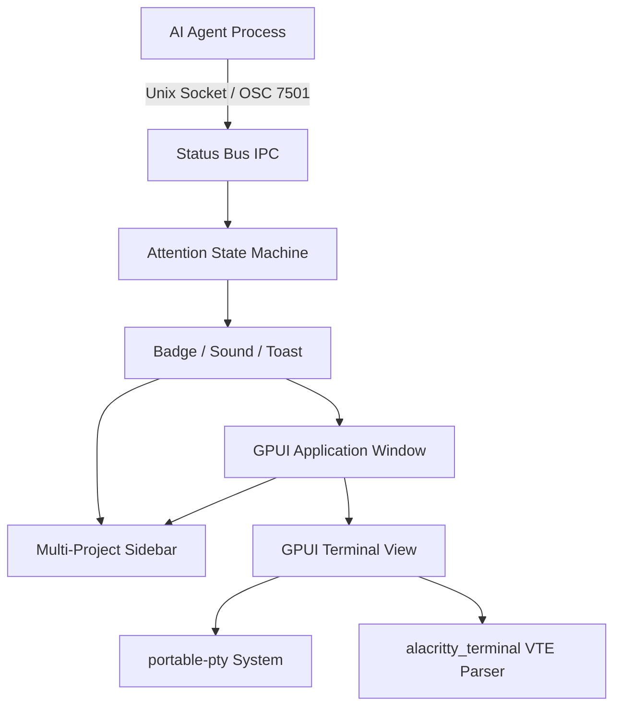

# Kathamo

> A GPU-accelerated terminal emulator built for developers orchestrating AI coding agents across multiple projects.

Kathamo combines native terminal rendering powered by [GPUI Fast](https://github.com/longbridge/gpui-fast) and [alacritty_terminal](https://github.com/alacritty/alacritty) with an intelligent **Agent Attention Model** and multi-project workspace management. It tracks the state of autonomous AI agents (Claude Code, OpenCode, Codex, Pi, OMP, Command Code) in real time—alerting you when an agent is blocked, waiting for input, or finished while you were away.

---


## Key Features

- **🚀 GPU-Accelerated Terminal Rendering**
  - Powered by GPUI Fast and Alacritty's VTE engine.
  - Adaptive 1 ms stream coalescing with a 128 KiB parse cap handles intensive outputs (e.g., 40 MB/s compilation logs) without locking the UI thread.
  - Full support for ANSI colors (16 standard, 256-color, 24-bit true color), bold, italics, underlines, and custom font glyphs.
  - Displays a plain terminal grid without block UI, with a Warp-style bottom input whenever the shell is idle. The input temporarily hides while a command runs or the alternate screen is active.

- **🤖 Native Agent Attention System**
  - **Agent Attention Protocol**: Strict attention priority hierarchy (`blocked > done > working > idle`).
  - **Unviewed Completion Latching**: If an agent finishes while its tab is not visible or the window is unfocused, it latches to `done` and alerts you. When you switch to it, it transitions cleanly to `idle`.
  - **Audio & Visual Notifications**: Dedicated audio chimes and system toasts for blocked queries and unobserved completions (`KATHAMO_NO_SOUND=1` supported).
  - **Sub-Agent / Worker Hierarchy**: Child sessions indented cleanly beneath parent agents without triggering duplicate alerts.

- **📁 Multi-Project Sidebar & Session Persistence**
  - Group terminal sessions cleanly under collapsible project folders in the sidebar.
  - Restores the full workspace on relaunch: projects, tabs, split panes, focus, per-pane working directories, input drafts, command history, window geometry, and the previous terminal output.
  - Agent conversations are saved to disk; rpi sessions resume on the next prompt.
  - Quick-action buttons to create new terminal sessions per project or open existing directories.

- **🔌 First-Class Agent Integrations & CLI**
  - Automated one-command setup for popular agent CLIs:
    ```bash
    kathamo integration setup
    ```
  - Built-in hook support for **Claude Code**, **OpenCode v2**, **Codex**, **Pi**, **OMP**, and **Command Code** (native Kathamo compatibility).
  - Explicit CLI reporting via `kathamo report <state> [message]` or standard OSC 7501 escape sequences.

- **🖥️ Desktop Polish**
  - Native window decorations and custom title bar controls.
  - Bundled custom application icons for Linux (`.desktop` auto-registration), macOS, and Windows.
  - Light, dark, and system appearance modes with Warp and GitHub terminal palettes.
  - Compatible terminal applications can follow light/dark changes while running using DEC mode 2031 and OSC 11.

---

## Architecture Overview



---

## Where Kathamo stores data

Kathamo uses the platform-native application directories (the same convention as Zed):

| Platform | Data | Settings |
|---|---|---|
| Linux | `~/.local/share/kathamo` | `~/.config/kathamo/settings.json` |
| macOS | `~/Library/Application Support/Kathamo` | `~/.config/kathamo/settings.json` |
| Windows | `%LOCALAPPDATA%\Kathamo` | `%APPDATA%\Kathamo\settings.json` |

The data folder holds `workspace.json` (projects, tabs, split layout, cwd), `sessions/` (per-pane terminal output), `conversations/` (agent transcripts), and `backups/`. Manage or clear it from **Settings → Data & Sessions**, or override the location with `KATHAMO_DATA_DIR=/absolute/path`. Set `KATHAMO_DISABLE_RESTORE=1` for a clean launch without reading saved state.

Processes are not resurrected: a restored pane starts a fresh shell in the saved working directory with the previous output shown above the new prompt.

---

## Installation & Building

### Prerequisites

- **Rust**: Version 1.85+ (Edition 2024 support)
- **Linux Packages**:
  ```bash
  sudo apt install -y libwayland-dev libxkbcommon-dev libfontconfig1-dev libssl-dev cmake pkg-config
  ```
- **macOS**: Xcode Command Line Tools.

### Build from Source

```bash
# Clone the repository
git clone https://github.com/olovalabs/kathamo.git
cd kathamo

# Build release binary
cargo build --release

# Run Kathamo
./target/release/kathamo
```

### Native agent chat

Kathamo's native agent view uses the [pi-rust](https://github.com/bigfish1913/pi-rust)
`rpi` executable. Install it before starting Kathamo:

```bash
cargo install rpi-cli --locked
```

Alternatively configure a provider using pi-rust's environment variables or
`~/.rpi/agent/models.json`; see the upstream documentation. The agent can read
and change files and execute commands in the project's working directory. Model
provider charges may apply.

In a terminal pane, select **Agent** in the bottom input bar to open a native
chat view. Enter sends a prompt, Shift+Enter inserts a newline, and Stop or
Ctrl+C cancels a running request. Select **Terminal** to return to the shell;
each pane keeps its own agent conversation while it remains open. Answer text
and reasoning/thinking appear incrementally as the agent sends them, rendered as
Markdown with syntax-highlighted code blocks. Thinking blocks fold into compact,
clickable accordions once the agent begins answering. Tool calls display all execution
details by default in rich cards: tool badges, call IDs (`#id`), inline argument summaries,
status badges, and line counts. Cards present pretty-printed input parameters and
streaming output blocks with dedicated one-click copy buttons for both arguments and results.
emits retry or compaction notices, these appear as clean activity updates.
Chat autoscrolling dynamically stays pinned to the bottom during live streaming and
asynchronous Markdown layout changes; scrolling up pauses autoscroll so you can read
earlier history without being yanked down, showing a floating "Scroll to bottom" button.
Agent processes are pre-warmed when entering Agent mode or choosing a model, and
idle cache warming is enabled so prompts do not wait for cold starts. A **⚡ Fast**
toggle in the bottom bar (or `/fast`, `/thinking <level>`) configures low reasoning
effort for fast responses, with a single click to switch to **🧠 Deep** reasoning.
Interactive rpi extension dialogs are not supported and are cancelled.

Type `/auth` in agent mode to open the provider authentication dialog. Select an
unauthenticated provider to start login, then follow its instructions; input is
masked. The list includes rpi's model catalog and configured providers. If an installed
authentication-only extension is not listed, enter its provider ID manually.
Readiness reports local configuration, not whether a provider accepts the key.
A ready provider is already authenticated; select it to choose a model, or use
**Add account** to sign in again explicitly.
Authenticating a provider does not switch the model of an existing agent session.
The dialog requires a Unix PTY; on other platforms use the provider's CLI login.

Select **Models** in the agent input bar or enter `/model` to see the available
rpi models and OMP Antigravity models. Select a row for the current pane, or
choose **Set default** to use that provider and model in new panes. Each pane
keeps the model shown in its input bar across restarts, so panes can run
different models side by side. **Reset default to rpi automatic model** clears
the saved default. Each selected model has a separate conversation within the
pane, and each conversation names its sidebar entry. For OMP models Kathamo asks
OMP's title generator once after the first completed turn, so the tab shows the
agent's own name (e.g. `🔄 REFSH: Refactor auth for token refresh`); until that
arrives, or if the backend does not generate titles, the first prompt supplies
the name. Plain shell tabs keep their shell title.

Google Antigravity additionally requires [oh-my-pi](https://github.com/can1357/oh-my-pi)
(`omp`) on `PATH`. In `/auth`, select **google-antigravity** if it is not ready,
complete the Google sign-in in a browser, then use `/model` to select an available
Antigravity model. If no models appear, retry discovery. These models run through
OMP, not rpi. Use **Use rpi automatic model** in `/model` to return to the
automatic rpi conversation. OMP interactive tool approvals and extension dialogs
are cancelled when they cannot be shown in this view.

---

## CLI Usage Reference

Kathamo acts both as a standalone GUI terminal and as a command-line helper for running shell sessions and agent scripts:

### Status Reporting

Report agent state from inside any terminal pane:

```bash
# Report active task
kathamo report working "Refactoring authentication module" --progress 35

# Request user decision or approval
kathamo report blocked "Waiting for API credentials" --kind auth

# Mark task completion
kathamo report done "All tests passed"

# Signal an error
kathamo report error "Compilation failed on status.rs"

# Clear status
kathamo report clear
```

### Agent Integrations Management

Configure agent CLI hooks automatically:

```bash
# Register hooks for Claude Code, Codex, Pi, OMP, and OpenCode
kathamo integration setup

# Inspect integration status across installed agents
kathamo integration status

# Run diagnostic verification
kathamo integration doctor

# Remove Kathamo integration hooks cleanly
kathamo integration remove
```

### Manual Status Inspection

```bash
# Query active terminal status
kathamo status

# Explain current state inference and detection evidence in JSON
kathamo status explain --json

# Clear current pane status
kathamo status clear
```

---

## Testing & Verification

Run the comprehensive test suites:

```bash
# Run core test suite
cargo test

# Run terminal emulator component tests
cargo test -p terminal

# Run OpenCode TUI integration tests (requires bun)
bun test tests/integrations/opencode-tui.test.ts

# Interactive terminal status demo script
./scripts/status-demo.sh working
./scripts/status-demo.sh blocked
./scripts/status-demo.sh done
```

---

## Repository Structure

```
kathamo/
├── assets/             # Icons, sounds, themes, embedded agent rule manifests
├── components/         # GPUI UI component library (fork of gpui-component)
├── terminal/           # GPU-accelerated terminal emulator widget
├── scripts/            # Development and demo utility scripts
├── src/                # Core application source
│   ├── attention.rs    # Agent attention state machine & priority ladder
│   ├── cli.rs          # CLI parser and command handlers
│   ├── integrations.rs # Automated agent hook configuration
│   ├── main.rs         # Application entry point, window & view layout
│   ├── conversations.rs # Append-only agent conversation history
│   ├── paths.rs        # Per-platform data/config directories
│   ├── settings.rs     # User settings & window geometry
│   ├── status.rs       # Agent status schemas & state definitions
│   ├── status_bus.rs   # Unix domain socket IPC bus
│   └── workspace_state.rs # Workspace/session/scrollback persistence
└── tests/              # End-to-end and integration tests
```

---

## Contributing

We welcome community contributions! Please read [CONTRIBUTING.md](CONTRIBUTING.md) for environment setup and contribution guidelines.

---

## License

Dual-licensed under either:

- **MIT License** ([LICENSE-MIT](LICENSE-MIT) or <https://opensource.org/licenses/MIT>)
- **Apache License, Version 2.0** ([LICENSE-APACHE](LICENSE-APACHE) or <https://www.apache.org/licenses/LICENSE-2.0>)

at your option.
