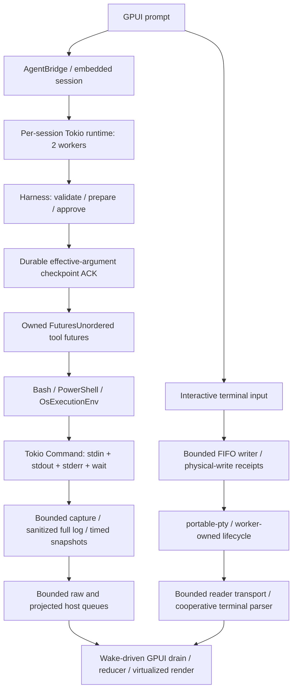

# Shell tool-call audit and optimization

## Result

The native tool runner already used Tokio and futures. The large delays were
in capture, lifecycle handling, transport and UI admission—not a missing async
runtime. Ripgrep is a content-search engine, not a shell execution engine;
replacing shell execution with `rg` would not address these problems. Earlier
embedded-ripgrep work is preserved, not rewritten by this audit.

Measured Linux improvements:

- Sparse second output: **223.190 → 22.151 ms** median, about 10× sooner.
- A 20 ms timeout: **123.259 → 21.745 ms** median settlement.
- Actual Bash-tool 1 MiB capture: **35.780 → 30.453 ms** median, while fixing the
  old incomplete log. This is not an identical-work comparison: the old log
  retained only the 100 KiB tail; the new log contains the complete stream.
- PTY setup no longer occupies the caller for the blocking setup operation:
  **0.500 ms** blocking control versus **0.012 ms** pending-call median.
- Native first output remains approximately **1.2 ms**. Cancellation remains
  approximately **0.2 ms**. No startup/cancellation speedup is claimed.

## Execution architecture



### Native AI tools

`src/agent_bridge.rs` opens `rpi_embedded::EmbeddedSession`. Its coordinator
owns a dedicated, two-worker Tokio runtime per conversation. The vendored CLI
session builder supplies models, tools, approvals, durable storage and the
harness. `rpi-agent` already owns concurrent tool futures in
`FuturesUnordered`; replacing these with detached tasks was unnecessary.

Validation, preparation, approval and the effective-argument durable checkpoint
remain before execution. A dedicated host emitter replaces only the unused CLI
broadcast observer for embedded sessions, which disable extensions. Existing
per-run durable/settling wrappers still wrap event emission. Auth restart
reopens the durable session instead of creating a persistent shell.

Bash and native PowerShell ultimately use `tokio::process::Command`. stdin,
both output pipes, process status, cancellation and deadlines are driven
concurrently. There is no `rpi` subprocess in this default path.

### Interactive terminal

Interactive terminals are a separate execution path: `portable-pty`, native
Unix PTYs or Windows ConPTY, `alacritty_terminal`, flume and GPUI. Blocking PTY
APIs stay on workers. A pipe-based Tokio `Child` cannot replace a PTY without
changing terminal semantics.

Both the application and standalone terminal now use `PendingPty` and the
shared FIFO writer. Setup, shell discovery/integration installation, handle
extraction, resize, signal/kill, wait and handle destruction run off GPUI.
Foreground-process inspection for Ctrl+C is also off GPUI. Parser/restoration
batches are at most 128 KiB and explicitly yield.

### Optional RPC

`KATHAMO_RPI_BACKEND=rpc` retains the installed-agent subprocess and JSONL
transport for supported routes. Its dedicated lifecycle/writer/reader workers
remain appropriate; spawning another Tokio runtime merely to replace those
workers would add complexity. Native Gemini/Antigravity routes remain embedded.
Old OMP comments and standalone benchmark remnants are not an active OMP backend.

## Dependencies and execution mechanisms

Versions below are those resolved during this audit, not new version pins.

| Component | Crates / mechanism |
| --- | --- |
| Native async execution | `tokio 1.53.2`: process, async I/O/fs, sync, timers, multithread runtime |
| Cancellation | `tokio-util 0.7.19` `CancellationToken`; `tokio::select!` around concurrent operations |
| Future composition | `futures 0.3.34`: `FuturesUnordered`, boxed futures, stream combinators |
| Host/background work | GPUI executors; existing `smol 2.0.2` blocking pool |
| PTY allocation/spawn | `portable-pty 0.9.0`; Unix PTYs / Windows ConPTY |
| Terminal parsing/rendering | `alacritty_terminal 0.25.1`, `gpui-fast` / platform `0.1.13` |
| PTY transport | `flume 0.12.0`, bounded FIFO frames and bounded errors/events |
| Shared state | `parking_lot 0.12.5`, short critical sections; no I/O under GPUI-held locks |
| Unix cleanup | `nix 0.29`, `libc`, validated process groups and child reaping |
| Windows cleanup | `win32job 2.0.3`, `windows-sys 0.59`, SDK suspended-child resume, existing `taskkill` fallback |
| Output decoding | `encoding_rs 0.8.42`, `codepage 0.1.3`, stateful split-chunk decoding |
| Serialization/logs | `serde`, `serde_json`, `tempfile`, `uuid`; asynchronous filesystem operations |

Tokio/futures already existed. The terminal crate now directly declares `smol`
and `libc`, versions already present in the application graph. No new runtime
or dependency version was introduced. An unrelated transitive flume 0.11.1
also remains; consolidating it was outside the measured shell bottlenecks.

## Confirmed bottlenecks and changes

| Before | Change / invariant |
| --- | --- |
| Sparse output waited for another chunk or process completion; nominal 100 ms throttle was not a quiet-period timer | One execution-local timer flushes dirty state during silence. First/final output is immediate; default subsequent checkpoints are 16 ms. `RPI_BASH_UPDATE_THROTTLE_MS` remains supported. |
| Timeout handling added an unconditional 100 ms after termination | Removed redundant post-reap padding; retained bounded pipe drain and process cleanup. |
| Legacy stdin command transport completed its write before driving output/status/deadlines | stdin write/shutdown runs concurrently with both output streams, status, cancellation and timeout. EOF behavior is preserved. |
| Dropping an execution future could leave child/process-group/registry state | Child `kill_on_drop`, process-group guard and tracked-PID cleanup cover abort/drop; successful intentional background descendants remain supported. |
| Slow output consumers could interfere with cancellation | Bounded async output seam; process/deadline/cancellation remain independently driven. Idle streams never reserve channel capacity. |
| Full-output log actually contained only the rolling tail | Persist every sanitized delivered byte; report no complete-log path after a spool failure. |
| Each small append caused repeated file-operation overhead | Reuse a 64 KiB spool batch and merge already queued backlog. Sparse output does not wait to fill a batch. |
| Rolling tail repeatedly shifted 100 KiB; truncation inserted lines at the front and allocated/recounted them | Logical-start tail with amortized compaction; lazy snapshots; contiguous UTF-8-safe suffix and known row count. |
| PowerShell ignored incremental update delivery | Reuse the same bounded, timed live-capture path while retaining native encoded invocation and platform policy. |
| Windows legacy-codepage discovery synchronously launched its probe on the decoder's runtime worker | First-needed probe is coalesced on a blocking worker and cached. ASCII/valid UTF-8 avoid it entirely. |
| Repeated shell metadata/probe work and complete environment cloning | Offload metadata work, cache the WSL detector regex, clean up probes; inherit the OS environment and remove private keys instead of explicitly cloning every entry before passing it to Command. Explicit environment overrides and `inherit_env = false` remain supported. |
| Unbounded host event/prompt queues and late snapshot projection/coalescing | Bounded producer-side admission; retain shared results before text projection; merge only identified updates within update-only segments; preserve lifecycle order/final results. |
| Unlimited drain work could monopolize a frame | Bounded poll batches, resignal pending backlog, preserve wake/yield behavior. |
| Full tool payload cloned before transcript truncation | Cap fields before copying into the bounded writer queue; surface overload/disk errors even when no new agent events arrive. |
| Repeated tool JSON parsing and irrelevant worker-list scans | Parse tool data once; borrow the parsed value; scan worker rows only when the worker view is open. |
| RPC spawn/restart/kill/wait/join could block GPUI | Lifecycle workers own process operations; drop is nonblocking and startup failures produce terminal events. |
| PTY setup/resize/write/destruction on GPUI; child handle dropped without wait | Shared pending lifecycle performs blocking operations on workers, coalesces resize, publishes actual exit status and reaps children. |
| Portable Unix kill added a redundant SIGHUP grace after a validated process-group SIGKILL | Skip that grace only after successful validated group termination; retain portable fallback otherwise. |
| PTY writes lacked bounded admission/physical completion/error signaling | FIFO admission includes in-flight bytes/frames, refuses atomically, exposes worker errors and physical-write receipts. Permanent failure rejects queued receipts instead of leaving waiters stuck. |
| Submission delays began before bytes were physically written; failure could erase drafts | Start existing Enter/attachment pacing after receipts; retain drafts/attachments on failure, avoid duplicate sends/automatic replay, cancel later Enter scheduling. Already accepted bytes cannot be recalled. |
| Parser batches could overshoot their limit or continuously consume backlog | Strict 128 KiB batches plus cooperative yielding, including restored scrollback; install the live notifier only after restoration. |
| Application retained unused raw command captures up to 4 MiB | App/demo opt out while retaining command ownership, status, cwd markers and visible terminal content. Library capability remains available. |

### Explicit backpressure budgets

| Boundary | Budget / behavior |
| --- | --- |
| Native capture | 8 output records, normally 8 KiB OS reads, plus bounded per-reader decoder data |
| Display capture | 100 KiB rolling tail; 50 KiB returned display output |
| Spool batching | 64 KiB, merge existing backlog without a fill delay |
| Raw embedded queue | 256 records / 4 MiB; one oversized record can enter exclusively |
| Projected host queue | 256 records / 4 MiB; same oversized-record rule |
| Host poll | At most 64 records / 256 KiB per poll; remaining work explicitly wakes the UI |
| Embedded commands | 65 slots / 32 MiB prompt bytes; reserved abort/shutdown admission |
| RPC writer | 4,096 ordinary commands / 32 MiB; reserved cancellation, adjacent abort coalescing |
| Transcript writer | 256 entries / 8 MiB including in-flight charge; 64 cached files; capped fields |
| PTY input | 4,096 frames / 32 MiB including in-flight writes; whole-frame admission |
| PTY lifecycle events | 4 records; bounded error delivery |

The 4 MiB host figures are **not absolute total heap bounds**: preserving an
oversized complete final result permits an exclusive oversized record, with
producer/in-flight records also alive. Synchronous progress may omit a
superseded intermediate snapshot under pressure. Async text/lifecycle admission
and final-result delivery remain lossless while the receiver is live.

## Benchmarks

### Native shell: before / after

15 samples each, Linux x86-64, agent workspace dev profile (unoptimized), two
Tokio workers, local Bash commands only. No network/model latency, approval
waiting, durable checkpoint or GPUI paint is included here. The standalone
`command_spawn` control measures `Command::spawn`, not an entire tool call.
Measurements are local engineering samples, not statistical guarantees.

The paced command prints once, sleeps 20 ms, prints again, then sleeps 200 ms.
Thus the second-output metric exposes waiting during silence rather than faster
execution of `sleep`. The cancellation timer starts after the ready marker.

| Metric | Before p50 ms | Before p95 ms | After p50 ms | After p95 ms |
| --- | ---: | ---: | ---: | ---: |
| Command spawn control | 0.152 | 0.204 | 0.169 | 0.455 |
| Raw first stdout | 1.131 | 1.290 | 1.191 | 1.380 |
| Raw first stderr | 1.137 | 1.296 | 1.199 | 1.392 |
| Raw execution total | 1.309 | 1.460 | 1.366 | 1.584 |
| Explicit-shell total | 1.420 | 1.922 | 1.254 | 1.678 |
| Raw 1 MiB total | 9.118 | 41.506 | 9.100 | 14.413 |
| Bash-tool first output | 1.046 | 1.242 | 1.117 | 1.502 |
| Bash-tool second paced output | 223.190 | 223.340 | 22.151 | 22.520 |
| Bash-tool paced total | 223.221 | 223.369 | 223.293 | 223.648 |
| Bash-tool 1 MiB capture | 35.780 | 38.300 | 30.453 | 32.515 |
| Cancel after ready → settle | 0.177 | 0.200 | 0.184 | 0.279 |
| 20 ms timeout → total settlement | 123.259 | 123.477 | 21.745 | 24.948 |

Raw startup/cancellation did not improve materially; some medians increased
slightly. The large repeatable wins are eliminating completion-gated progress
and unnecessary timeout waiting. The raw-throughput p95 difference alone is not
proof of a general throughput improvement. The full-log comparison also changes
correctness/work performed, as noted above.

Reproduce the final benchmark:

```sh
cargo run --manifest-path agent/Cargo.toml -p rpi-tools --example bench_shell -- 15
```

The example checks stream payloads and removes its output logs. Intermediate
runs overlapped compilation and were noisier; the table uses the final run
without concurrent build work.

### PTY caller responsiveness and cleanup

15 samples, application dev profile with optimized dependencies. This is a
blocking portable-PTY control versus the new pending API, not an end-to-end
before/after UI benchmark. Do not compare absolute times across these and the
unoptimized agent-workspace measurements.

| Metric | p50 ms | p95 ms |
| --- | ---: | ---: |
| Blocking setup: caller occupied | 0.500 | 0.647 |
| Blocking setup: first output | 1.550 | 1.692 |
| Pending setup: caller occupied | 0.012 | 0.090 |
| Pending setup: first output | 1.923 | 2.073 |
| Pending close: caller occupied | <0.001 | <0.001 |
| Pending close: child settled | 0.167 | 0.213 |

Worker scheduling slightly increases first-output latency while substantially
reducing caller occupancy. An intermediate new-path measurement took 50.187 ms
median to settle; removing redundant portable kill grace reduced it to 0.167 ms.
That intermediate number is not a baseline for the original application's
previously untracked child lifecycle.

```sh
cargo run --example bench_pty -- 15
```

### Transport, persistence and rendered UI

These are final-state measurements, not claimed before/after UI speedups:

| Scenario | Observed result |
| --- | --- |
| Local SSE fixture, warm provider request | 0.593 ms median |
| Local SSE fixture, warm send → first delta | 1.465 ms median |
| Local SSE fixture, cold/resumed first delta | 32.380 ms median |
| Producer delta → host apply, warm | 19 µs median / 28 µs p95 |
| Cancellation → settled, integrated fixture | 674 µs, one sample |
| 40 mixed read/Bash fixture tools: start → end | 1.587 ms median / 9.139 ms p95; not Bash-only |
| Tool end → model delta | 1.109 ms median / 3.725 ms p95 |
| Slow RPC reader: prompt enqueue | 27 µs |
| Slow RPC reader: 2,000 aborts | 725 µs total; 19 µs worst enqueue |
| 1,000 capped projections of a 1 MiB event | 1.376 ms total versus 21.781 ms for full-clone control; 64 KiB retained prefix |
| Render fixture: tool arrival → apply | 4 µs median / 10 µs p95 |
| Render fixture: tool arrival → card paint | 0.513 ms median / 1.077 ms p95 |
| Render fixture: tool start → output paint | 10.842 ms median / 14.979 ms p95 |

The render fixture emits its update on the next frame, before ToolEnd; its
output-paint number includes that intentional frame sequencing, not just queue
latency. The inspected screenshot shows `Running printf ready` and `ready`
output simultaneously. Live-update rendering was verified, not only the final
collapsed tool card. Screenshot: `/tmp/kathamo-shell-tool-card.png` in the audit
environment.

Two concurrent embedded conversations increased fixture process threads from
6 to 10, matching retained two-worker runtime isolation. Provider request,
resolution and inference latency are separate from shell startup. There was no
usable pre-change GPUI test harness baseline, so no frame-speedup claim is made.

## Verification exercised

| Check | Result |
| --- | --- |
| `rpi-tools` lib + Bash + throttle + pipe/stdin + execution-env conformance + host-private-env suites | 178 passed across six suites |
| Final environment-inheritance change: conformance + host-private-env rerun | 9 passed |
| `terminal --lib` | 133 passed, 1 ignored |
| PTY lifecycle selection after kill-grace optimization | 9 passed |
| `rpi-embedded --lib` | 13 passed |
| Reserved command/byte-budget admission after atomic-loop adjustment | 1 passed |
| Root bridge / writer / conversation selections | 8 / 4 / 10 passed; one optional conversation benchmark ignored in that selection |
| Transcript projection benchmark, explicitly selected | Passed |
| Root application test harness build | Passed |
| Standalone terminal binary check | Passed |
| Actual GPUI prompt submission / attachment / focus ownership / failed-write draft retention flows | All four passed |
| Local SSE integration script | Cold/resume/warm/burst, cancellation, concurrency, recovery, 40 real read/Bash tool turns, slow writer, Gemini tool round-trip and provider-switch context passed |
| Live tool-feedback frame benchmark and screenshot inspection | Passed |

Core regression coverage includes simultaneous stdout/stderr, stdin EOF,
capacity-one output, slow consumers, cancellation/timeout under full queues,
dropped futures, process/descendant cleanup, complete multi-megabyte logs,
split ANSI and encoding boundaries, Unicode truncation, sparse checkpoints,
PTY physical-write errors, failed queued receipts, actual child status,
resizes before readiness and ownership teardown. Existing label-only/wording
assertions were removed rather than repinned.

Representative commands used:

```sh
cargo test --manifest-path agent/Cargo.toml -p rpi-tools --lib \
  --test bash --test bash_throttle --test bash_stdout_and_stdin_hold \
  --test execution_env_conformance --test host_private_env
cargo test --manifest-path agent/Cargo.toml -p rpi-embedded --lib
cargo test -p terminal --lib
cargo check -p terminal --bin terminal
cargo test --bin kathamo --no-run
```

The existing integration driver was run against the built root test harness:
`python scripts/bench-agent-stream.py <root-test-harness>`. It uses isolated local
SSE fixtures/configuration, not external credentials or paid inference. Narrow
root selections and ignored benchmarks were invoked directly on that harness.
No unrelated repository-wide suite was run.

## Changed-file inventory

Only shell-audit changes are described here; pre-existing ripgrep changes are
not attributed to this work.

| File | Change |
| --- | --- |
| `agent/crates/rpi-tools/src/env.rs` | Bounded async output seam and chunk type |
| `agent/crates/rpi-tools/src/lib.rs` | Export chunk type |
| `agent/crates/rpi-tools/src/in_memory.rs` | Honor async output in the virtual execution environment |
| `agent/crates/rpi-tools/src/os_env.rs` | Concurrent process/I/O lifecycle, cancellation/drop cleanup, metadata/probe work, safe direct environment inheritance |
| `agent/crates/rpi-tools/src/output_decode.rs` | Coalesced off-worker Windows codepage discovery; async decoding path |
| `agent/crates/rpi-tools/src/shell_output.rs` | Single-consumer bounded capture, full spool, batching, timer, amortized tail, stateful sanitization |
| `agent/crates/rpi-tools/src/tools/bash.rs` | Shared capture, lazy checkpoints, 16 ms default |
| `agent/crates/rpi-tools/src/tools/powershell.rs` | Shared live capture/update path |
| `agent/crates/rpi-tools/src/truncate.rs` | Linear contiguous suffix, UTF-8/byte boundaries, exact row metadata |
| `agent/crates/rpi-tools/tests/bash.rs` | Full-output/sanitization regressions; remove incidental assertions |
| `agent/crates/rpi-tools/tests/bash_throttle.rs` | Sparse/first/final progress behavior |
| `agent/crates/rpi-tools/tests/bash_stdout_and_stdin_hold.rs` | Concurrent pipes, bounded queues, lifecycle/cancellation regressions |
| `agent/crates/rpi-tools/examples/bench_shell.rs` | Reproducible native execution/capture benchmark |
| `agent/crates/rpi-embedded/src/lib.rs` | Dedicated host emitter, bounded queues/admission, early coalescing, bounded completion and fair polling |
| `agent/crates/rpi-cli/src/interactive_tui.rs` | Remove obsolete capture-lock comment; no behavior change |
| `src/agent_bridge.rs` | Bounded transport, identity-safe coalescing, fair delivery |
| `src/agent_bridge_rpc.rs` | Worker-owned RPC lifecycle, nonblocking teardown and terminal startup events |
| `src/agent_writer.rs` | Bounded byte/command admission and reserved cancellation |
| `src/conversations.rs` | Pre-copy transcript projection, bounded persistence and visible errors; benchmark |
| `src/main.rs` | Pending PTY integration, receipt/cancellation-aware submission, visible failures, fair UI integration, single tool parse and exercised GPUI regressions/benchmark |
| `terminal/Cargo.toml` | Declare existing smol/libc dependencies |
| `terminal/src/pty_session.rs` | Shared pending setup/control/cleanup and lifecycle tests |
| `terminal/src/pty_writer.rs` | Bounded FIFO, physical receipts, worker errors, failure draining and tests |
| `terminal/src/event.rs` | Queue live notifier writes through the shared FIFO |
| `terminal/src/view.rs` | Queued input/error relay, cooperative parser/restoration, visible lifecycle state |
| `terminal/src/lib.rs` | Export shared lifecycle/writer APIs |
| `terminal/src/terminal.rs` | Forward raw-capture option |
| `terminal/src/shell_integration.rs` | Optional raw capture while preserving ownership/status/cwd parsing |
| `terminal/src/main.rs` | Standalone adoption of shared PTY lifecycle and current focus API |
| `examples/bench_pty.rs` | Caller-occupancy, first-output and cleanup benchmark |
| `Cargo.lock` | Root dependency contract for terminal's existing smol/libc |
| `terminal/Cargo.lock` | Same standalone dependency contract; no new package versions |
| `agent/crates/rpi-tools/README.md` | Document output/backpressure/capture semantics and benchmark |
| `ARCHITECTURE.md` | Document native queues, shell capture, PTY and persistence ownership |
| `CHANGELOG.md` | User-visible streaming/lifecycle/backpressure changes |
| `SHELL_TOOL_AUDIT.md` | This inventory, architecture, evidence and limitations |

## Preserved behavior and remaining limits

- **No GPUI shell/PTY I/O waits:** blocking process/PTY/filesystem lifecycle work
  is on runtime/background workers. `Command::spawn` itself still performs
  synchronous OS process creation, but not on GPUI. UI parsing/layout/painting
  still costs CPU; this is not a claim of zero UI work or zero OS latency.
- **Child buffering:** immediate parent-side draining cannot force arbitrary
  programs/libraries to flush their own stdout. PTYs retain terminal behavior;
  noninteractive commands are not silently converted into PTYs.
- **Custom callbacks:** legacy synchronous execution callbacks remain inline for
  existing environment consumers and must stay cheap. Application capture uses
  the bounded async channel; this is not a guarantee against arbitrary blocking
  work supplied by another caller.
- **Security/permissions:** shell argument transport, working directory,
  environment overrides, host-private filtering, tool approval and durable
  checkpoint ordering are retained. No persistent shell pool, permission bypass
  or new automatic command replay was introduced.
- **Normal descendants:** intentional daemons may survive successful execution.
  Post-exit capture uses a 100 ms idle grace plus at most 1 MiB of immediately
  ready bytes per pipe, not an endless descendant logger. Abort/drop paths clean
  up the owned process group. Logs contain sanitized delivered output, not
  arbitrary future bytes after cancellation or bounded post-exit drain.
- **Storage:** slow/uninterruptible filesystem work can delay complete-log
  delivery; child termination is independently driven. Finite-memory,
  nonblocking transcript persistence cannot promise infinite lossless retention
  against a permanently stalled disk. Overload/failure is surfaced as an unsaved
  entry rather than silently claiming success.
- **Budgets:** oversized final events are explicitly allowed exclusively;
  in-flight/producer state exists beyond queue budgets. These are bounded
  backpressure policies, not a false universal fixed heap ceiling.
- **Runtime isolation:** per-conversation Tokio runtimes and the existing GPUI/
  smol executors remain. No speculative consolidation or extra per-PTY runtime
  was added. Model/auth/checkpoint costs are not shell performance defects.
- **Platforms:** execution, benchmarks and visual verification were Linux only;
  only the Linux Rust target was installed. Windows/macOS behavior was not
  runtime-verified. A first Windows legacy-codepage query may still incur probe
  startup latency; it no longer blocks a Tokio worker and may finish in the
  background after cancellation.
- **Warnings:** existing third-party `proc-macro-error2` future-incompatibility
  and an unused test import in `terminal/src/agent_status.rs` remain unrelated
  warnings, not suppressed by this work.
